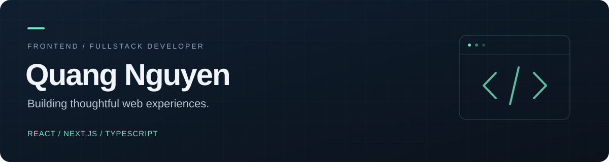

I build web applications with **React, Next.js and TypeScript**, with a focus on clear interfaces, practical business workflows and reliable data flows.

My work spans **ERP systems, mobile miniapps and fullstack products** — from order management and role-based access to real-time updates and native-app integration.

### What I work with

**Frontend** · React · Next.js · TanStack Start · TypeScript · Tailwind CSS  
**State & data** · Zustand · TanStack Query · REST APIs · Socket.IO  
**Backend & storage** · Node.js · Fastify · PostgreSQL · Drizzle · Prisma  
**Interaction** · Framer Motion · WebView · PWA

### Selected personal projects

<table>
<tr>
<td width="33%" valign="top">

**Anime Social**

A community platform with a user app, an admin CMS and a backend. Posts, reactions, friendships, direct messaging and moderation.

React · TanStack Start · Fastify · PostgreSQL · Socket.IO

</td>
<td width="33%" valign="top">

**BranchTrip**

A travel planner for building itineraries, comparing alternative plans, tracking budgets and sharing read-only trips. Includes maps and saved offline views.

TanStack Start · Drizzle · PostgreSQL · MapLibre

</td>
<td width="33%" valign="top">

**Restaurant Manager**

A restaurant management interface for dishes, tables, guests and orders, with live order updates and multilingual navigation.

Next.js · TanStack Query · Zustand · Socket.IO

</td>
</tr>
</table>

These selected projects currently have private source repositories.

### Public code to explore

- **[Kanban Task Board](https://github.com/concacotdua/trello-react-ts)** — drag-and-drop columns and cards, cross-column moves, touch interactions and REST API integration.
- **[Scratch Blog](https://github.com/concacotdua/scratch-blog)** — a Next.js blog with Supabase, query caching and a Tiptap rich-text editor.

### Professional focus

At **Vua Tho**, I develop ERP interfaces and event miniapps, integrate real-time data and mobile WebViews, and maintain and extend e-commerce features across the storefront, CMS and APIs.

---

Thoughtful interfaces. Practical engineering. Continuous improvement.
